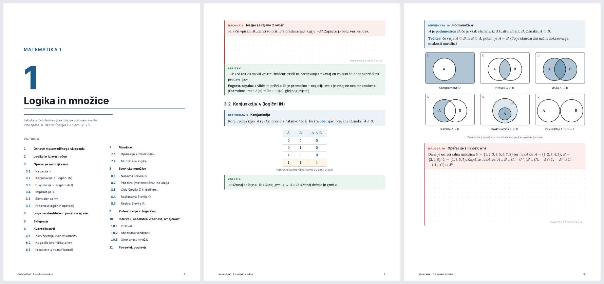

# lecture-notes — slides → print-ready study workbook

A Claude skill that turns one lecture's slides (PDF) into a designed, printable workbook:
explained notes, the lecturer's definitions verbatim, diagrams where the concept has structure,
and **every exercise from the slides with a workspace to solve it and a worked solution underneath**.



Real example: 176 Beamer slides (Matematika 1 — Logika in množice) → 33 A4 pages, 11 sections,
22 exercises solved, 10 diagrams, per-section video links. See [`skills/lecture-notes/examples/output.pdf`](skills/lecture-notes/examples/output.pdf).

## Why

Slides are a speaking aid. They list bullets, skip the "why", repeat every slide 3–5× for overlays,
and leave exercises unsolved because the lecturer does them on the board. Dropping a whole semester
of PDFs into a chat and hoping produces mush. This skill works one lecture at a time with a fixed
structure and a fixed design, so a course's notes look like one book when printed and bound.

## What you get

- A4 PDF with cover + table of contents, numbered sections, running footer, binding margin
- Colour-coded boxes: Definicija · Izrek · Zgled · Ideja · Pozor · Naloga · Rešitev (labels in sl / en / de / hr / it)
- Real math typesetting (KaTeX), tables, SVG diagrams from a parametric catalog (truth tables, Venn, number lines, nested sets, trees, timelines, induction, …)
- Exercises as a workbook: statement → dotted workspace → solution with explanation (or all solutions in an appendix)
- Slide errors flagged, not silently corrected
- Mathematics lectures only: a "Video razlage" box per section with Andrej P. Škraba's matching videos (looked up via astra.si); other subjects get none

## Install

**Claude Code**

```
/plugin marketplace add SaB11F/lecture-notes-skill
/plugin install lecture-notes@lecture-notes-skill
```

or copy `skills/lecture-notes/` to `~/.claude/skills/lecture-notes/`.

**Claude.ai / Claude desktop (Cowork)** — download `lecture-notes.skill` from [the latest release](https://github.com/SaB11F/lecture-notes-skill/releases/latest/download/lecture-notes.skill) (not GitHub's *Code → Download ZIP*, which claude.ai rejects) and use *Save skill*, or paste `SKILL.md` into Settings → Skills. The scripts run in Claude's sandbox; the skill clones this repo there on first use.

## Requirements

Install these once before the first run. `scripts/setup.sh` installs the rest (`markdown-it-py`, `mdit_py_plugins`, `playwright` + Chromium ~150 MB, `katex`) and needs internet access.

| Tool | Why |
|---|---|
| Python 3.10+ (as `python3`) | extract and build scripts |
| `pdftotext` (poppler) | slide text extraction |
| Node.js + npm | KaTeX math rendering |
| bash | runs `setup.sh` |

**macOS**

```bash
brew install python poppler node
```

**Debian / Ubuntu**

```bash
sudo apt-get install -y python3 python3-pip poppler-utils nodejs npm
```

**Windows** — use Git Bash (comes with [Git for Windows](https://git-scm.com/download/win)) as the shell.

```bash
winget install Python.Python.3.12 OpenJS.NodeJS.LTS
```

```bash
scoop install poppler
```

Without [Scoop](https://scoop.sh), download poppler from [oschwartz10612/poppler-windows](https://github.com/oschwartz10612/poppler-windows/releases) and add its `Library\bin` to `PATH`. The Python installer creates `python`, not `python3`; either replace `python3` with `python` in the commands, or create an alias in Git Bash:

```bash
echo 'alias python3=python' >> ~/.bashrc
```

Check:

```bash
python3 --version && pdftotext -v && node --version
```

**Claude.ai sandbox** — needs code execution enabled and network access allowed for pip, npm and the Chromium download; if the sandbox blocks them, use Claude Code instead.

## Use

Attach one lecture PDF and say something like:

> Make study notes from these slides — Matematika 1, chapter 1.

Claude extracts and deduplicates the slides, plans sections, writes `content.md` in the dialect described in
[`references/content-format.md`](skills/lecture-notes/references/content-format.md), builds the PDF, renders every page
to check it, and hands you the file. Options go in the frontmatter of `content.md`:

```yaml
lang: sl            # box labels and workspace text
accent: "#1d5c8a"   # one colour per course
solutions: inline   # or: end  → solutions appendix
binding: left       # or: none
```

## Repo layout

```
skills/lecture-notes/
  SKILL.md                 the skill: workflow + rules
  scripts/extract.py       PDF → deduplicated slide text (overlay-aware)
  scripts/build.py         content.md → HTML → PDF
  scripts/diagrams.py      @@ diagram catalog (parametric SVG)
  scripts/render_check.py  contact sheets for visual QA
  scripts/setup.sh         dependencies
  theme/theme.css          the design
  references/              content format, writing rules, diagram catalog
  examples/                a complete lecture: content.md → output.pdf (source slides not included)
```

## Build by hand

```bash
bash skills/lecture-notes/scripts/setup.sh
python3 skills/lecture-notes/scripts/extract.py slides.pdf work/slides.txt
# write work/content.md (see examples/content.md)
python3 skills/lecture-notes/scripts/build.py work/content.md out/notes.pdf
python3 skills/lecture-notes/scripts/render_check.py out/notes.pdf
```

## Contributing

Diagram generators live in `scripts/diagrams.py` — add a function, register it in `REGISTRY`, document it in
`references/diagram-catalog.md`. New languages: add a row to `I18N` in `build.py`. Design changes go in `theme/theme.css` only.

MIT © Rene Kolednik
